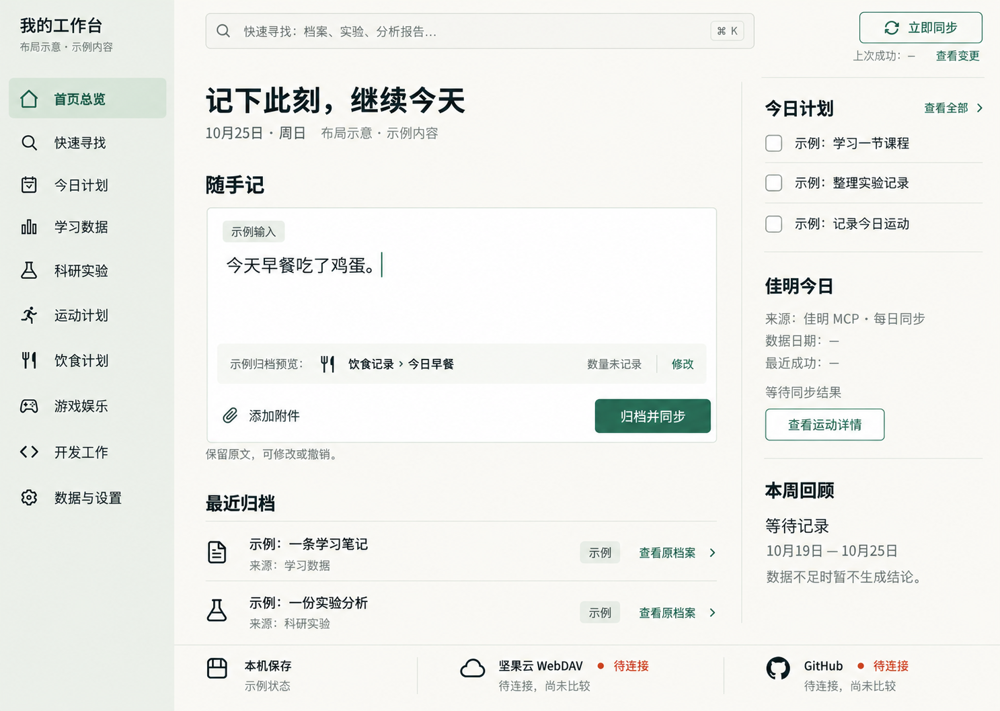

# 个人工作生活 APP · 产品需求文档

版本：1.0  
整理日期：2026-10-25（Asia/Shanghai）  
用途：供后续在同一项目中工作的 Codex 读取，作为页面设计、技术方案、开发与验收的依据。  
当前阶段：需求与界面方向已确认，尚未开发 APP。本文件中的“必须”描述交付要求，不表示功能已经实现或通过验收。

## 阅读与交接约定

- **用户已确认**：产品范围、导航顺序、首页重点、同步方向及选定的界面设计，以本文件为准；后续用户的新指令优先。
- **最小落地定义**：为把已确认用途写成可开发、可检查的要求，本文补充必要字段、操作、状态与验收场景。这些是产品细化，不是已存在的软件能力。
- **待定实现**：桌面技术栈、本地存储引擎、自然语言整理方案、同步协议细节等尚未选定，见第 11 节。不得写成用户已经指定，也不得用“待定”删掉对应必做功能。
- 本文保存的是当前最新要求。旧讨论中“佳明截图导入”“每日记录作为侧栏父级”“GitHub 只上传备份”等已被后续决定替代。
- 本轮只保存 PRD 和选定设计图，不创建应用工程、不安装依赖、不开发代码、不连接或迁移云端数据。

## 1. 产品目标和使用场景

### 1.1 产品目标

制作一个首先供本人使用、在当前电脑本地运行的工作生活专属 APP。把零散的生活记录、计划、学习、科研、运动、饮食、娱乐和开发工作统一到同一套个人 AI 档案中。

核心体验：打开就能看到今天的安排；用一句日常语言记下一件事；快速找到某份档案或分析报告；清楚知道数据保存在哪里、有没有同步成功。

首版优先稳定、数据不丢、操作直接和免费使用。刷新页面、关闭 APP、重新启动后，已经保存的数据必须保留。断网也能查看和记录本机内容。

云端采用用户已有的坚果云 WebDAV 为主通道，GitHub 为第二通道，不要求自购云服务器或托管云数据库。GitHub 同时也是可编辑的数据来源，其修改必须回到 APP 并进入坚果云同步。

未来可演进为多人各自登录账号、隔离各自数据并同步的通用 APP；首版先完成个人模式，不提前实现多人系统。

### 1.2 典型使用场景

| 场景 | 用户做什么 | 应得到的结果 |
| --- | --- | --- |
| 记录日常 | 在首页输入“今天早餐吃了鸡蛋” | 自动识别为当天的饮食事实，预览归档位置，提交后本机保存并同步；保留原文，不补造数量 |
| 安排今天 | 查看今日计划，将学习、科研或训练事项安排到今天 | 首页与今日计划显示同一项安排，可以调整、完成、延期并回到来源 |
| 接收聊天归档 | 在有权访问档案的聊天中，内容已经实际写入 GitHub 或坚果云的同一套档案 | APP 启动、使用中检查或点击“立即同步”后，接收到该修改 |
| 查找资料 | 搜索实验关键词、笔记内容、档案名称或分析结论 | 显示命中片段和来源，点击直达具体内容，而不是只打开模块首页 |
| 查看运动 | 已有佳明 MCP 流程完成每日采集和归档 | 首页读取实际数据摘要、所属日期和更新时间；运动模块查看计划、实际记录与分析 |
| 网络暂不可用 | 继续写随手记、编辑档案或调整计划 | 本机先保存，明确显示待同步；恢复连接后补传，不要求重新录入 |
| 直接编辑云端 | 在 GitHub 修改已有档案 | 修改回到本机 APP，并由统一流程同步到坚果云，保留本机尚未上传的修改 |

### 1.3 首版边界

- 先在当前电脑上实际运行和验收；当前工作环境为 macOS。桌面应用形式及其他桌面平台的打包范围待技术方案确定。
- 联网用于云端同步和已有数据来源接入；本机保存、查看、编辑和本地搜索不依赖持续联网。
- 免费优先，不默认购买服务器、数据库或付费 AI 服务。用户的现有服务额度不足时须明确提示，不能假定无限免费。
- 不需要部署 Android 手机端。首版不包含手机、平板或多人协作产品。
- 项目正式名称尚未确定；设计图中的“我的工作台”为展示名称。

## 2. 整体页面框架和导航结构

### 2.1 固定导航顺序（用户已确认）

以下十个入口为**同级入口**，按顺序排列：

1. 首页总览
2. 快速寻找
3. 今日计划
4. 学习数据
5. 科研实验
6. 运动计划
7. 饮食计划
8. 游戏娱乐
9. 开发工作
10. 数据与设置

“快速寻找”在“今日计划”前面。学习数据和科研实验在今日计划后面，各自独立，不做成今日计划或每日记录的子分支。“每日记录”不作为首版侧栏入口。

文件目录和页面导航是两个概念。此前档案已将学习、科研目录放入“每日记录”下，APP 可以使用独立导航读取这些目录，不因导航调整再擅自搬动档案。

### 2.2 通用页面框架

- 左侧：固定导航，当前入口清晰高亮。
- 顶部：全局快速寻找输入框；进入独立搜索页时沿用同一查询与结果规则。
- 主体：各模块自身的列表、内容或详情，不能统一套用同一种任务列表。
- 首页右上方：立即同步、上次成功时间、查看变更。
- 记录详情：显示标题、日期、所属模块、来源；提供查看原档案和必要的编辑入口。
- 保存和同步状态使用文字说明。状态色仅辅助表达，不以绿色图标代替实际核对结果。

### 2.3 已选定的界面设计（后续 Codex 必须读取）

用户选择了：**原布局探索中的第 3 张“随手归档”布局，经过功能修订后的第 2 套“暖白松绿”配色。**

当前项目中的唯一选定参考图：

- 文件：`design/home-selected-warm-white-pine.png`。
- 原图尺寸：1487 × 1058 像素。
- 原始生成文件标识：`exec-30a8eaa0-fa58-437b-a500-3afb6ad5cc69.png`。
- 这是最新配色轮次的第 2 张，不是早期布局探索的第 2 张。
- 主视觉：暖白主背景、浅灰绿色侧栏、深松绿色强调色、深色文字、轻分隔线；保持舒适留白。
- 结构：中央主要是大幅随手记；其下为最近归档；右侧为今日计划、佳明今日和本周回顾；顶部搜索与立即同步；底部区分本机、坚果云和 GitHub 状态。
- 保留这种布局和视觉层级，不擅自换成卡片堆叠、日历主导或深色主题。
- 图中的早餐、计划、档案条目和同步状态均为示例。正式 APP 必须展示真实数据或明确的空状态，不能把示例当成用户记录。
- 图是首页静态设计依据，不是可运行原型。其他页面尚未绘制完整视觉稿，按本文的页面用途与交互细化。
- 当静态图的占位文案与本文业务要求不同，以本文为准；例如各云端的独立同步时间和完整差异列表可在同步详情中展开。

以下是根据生成设计稿给出的**开发起始色值建议**，不是逐像素测量值：

| 用途 | 建议色值 |
| --- | --- |
| 主背景 | `#FAF9F5` |
| 侧栏背景 | `#EDF1EB` |
| 输入区 | `#FFFFFF` |
| 主文字 | `#24352F` |
| 次文字 | `#6B776E` |
| 分隔线 | `#DCE3DA` |
| 主强调色／主按钮 | `#376958` |
| 当前导航背景 | `#DBE8DA` |

文字使用清晰的中文无衬线字体，正文建议 14–16px。桌面窗口变化时要保持内容可读，不能裁掉保存、归档或同步操作；具体响应式断点由开发确定。

## 3. 首页的内容结构

首页是日常记录和总览工作台。主次顺序是：**随手记 → 今天的安排与需要关注的信息 → 最近档案和运动／周报摘要**。

### 3.1 顶部工具区

- 全局搜索：提示可寻找档案、笔记、实验和分析报告。
- 立即同步：主动检查并执行本机与已连接云端的双向同步，不仅上传。
- 上次成功时间：总览给出摘要，展开后分别列出坚果云和 GitHub 的上次成功时间、最近尝试与当前状态。
- 查看变更：查看本机与云端最近核对的新增、修改、删除、冲突、来源和待传内容。尚未连接或尚未比较时明确显示，不能声称一致。

### 3.2 中央主区：随手记

随手记用于把日常语言整理进档案，不只保存一张无归属便签。

基本流程：

1. 输入日常描述，可附加普通附件。
2. 保留原文，同时给出归档类型、日期和归属的预览；用户可直接修改归属。
3. 点击“归档并同步”，先完成本机保存，再进入云端同步。
4. 显示实际结果，并提供查看记录、修改或撤销入口。

必须支持的语义边界：

- “今天早餐吃了鸡蛋”属于已发生的饮食记录，不自行补成“两个鸡蛋”，不凭空计算准确热量。
- “明天准备吃鸡蛋”属于计划，不能被算成今天实际吃过。
- 日期按用户所在时区解释；不明确的内容可修改。默认时区为 Asia/Shanghai。
- 不确定分类或复杂输入也要先保留原文，可进入“待整理”；不能为了强行分类丢内容。
- 一段输入涉及多个事项时，原文与整理出的事项保持关联，避免被多个页面分别复制为互不相关的记录。
- 自动整理是首版必须实现的用户体验。具体使用规则、本地模型或其他服务尚待确定；不能默认接入收费模型，也不能用静态演示冒充已经完成。
- 本机保存失败时保留当前输入并清楚提示，不能显示“归档成功”。网络失败时保留已保存的记录和待同步状态。

普通附件用于保留资料与上下文。首版不包含食物照片识别；佳明也不采用截图导入作为日常流程。

### 3.3 最近归档

展示最近实际新增或修改的记录，至少显示标题、所属模块、日期或更新时间。点击进入对应详情；提供“查看原档案”。空白模板、说明文档、文件搬迁不能被算成一次真实学习或实验成果。

### 3.4 右侧摘要区

| 区块 | 首版内容 | 点击后的去向 |
| --- | --- | --- |
| 今日计划 | 当天主要待办、来源、时间或优先级、状态 | 今日计划或该事项来源 |
| 佳明今日 | 现有 MCP 链路实际产出的数据摘要、数据所属日期、最近成功更新时间、缺项状态 | 运动计划中的详情 |
| 本周回顾 | 实际记录形成的周报入口、摘要及覆盖日期 | 对应周报／分析报告 |
| 需要关注 | 有来源的逾期事项、同步冲突、数据过期或当前重点 | 对应事项、记录或同步详情 |

区块可随内容多少展开或排列，不为填满画面虚构指标。数据不足时显示“尚未记录”“数据不足”或相应缺项，不能凭缺失数据判断“一切顺利”。

佳明沿用用户已有的 MCP 每日同步和档案结果，不重复创建定时采集任务，不要求手动上传运动截图。数据属于哪一天与什么时候读取成功必须分开，旧数据不能伪装成今日实时数据。当前是否采集成功以实际状态为准，不以“已配置每日任务”代替成功。

周报和提醒首版至少支持已有报告读取、实际数据统计和可解释的规则摘要。数据事实、已有原文和系统建议分开标明；复杂自由分析的实现方式见第 11 节。

### 3.5 底部保存与同步状态

分别显示本机、坚果云、GitHub 状态，例如：已保存本机、待同步、正在同步、部分成功、需要处理冲突、待连接。网络失败不能使已经保存的随手记丢失，也不能显示为云端成功。

## 4. 每个模块的用途

| 模块 | 用途 |
| --- | --- |
| 首页总览 | 快速记录，查看今天的重要安排及各模块摘要，发起同步 |
| 快速寻找 | 全局关键词定位具体档案、学习笔记、实验、记录及分析报告 |
| 今日计划 | 统一安排今天要做的事，关联各模块并维护计划状态 |
| 学习数据 | 按具体科目组织笔记、材料、实际学习进度、疑问与下一步 |
| 科研实验 | 按课题查看科研进度、科研内容总结、前置资料和具体实验 |
| 运动计划 | 查看佳明数据、训练建议、调整后的训练计划、实际运动和复盘 |
| 饮食计划 | 安排和记录日常饮食，接收随手记整理出的饮食事实 |
| 游戏娱乐 | 管理游戏清单、游玩进度和娱乐记录 |
| 开发工作 | 管理开发项目、阶段目标、问题与版本记录，并关联仓库 |
| 数据与设置 | 管理本地档案、云端连接、同步状态、备份、恢复与导出 |

学习数据以科目为主，ODE、PDE 只是用户举例，不是已经确定的完整分类。正式分类以后以用户实际提供的 Obsidian 结构为准。科研前置阅读、论文、课题资料和实验放入科研实验，不混入学习科目。

## 5. 每个模块第一版最必要的数据和操作

以下为最小落地定义。字段允许为空并标注“未记录”，不能为了补全表单编造事实；与现有档案有对应内容时优先关联原记录。

| 模块 | 最必要的数据 | 第一版操作 |
| --- | --- | --- |
| 首页总览 | 随手记原文、整理结果、时间、归属、保存状态；实际摘要与来源；各端同步状态 | 输入并归档、纠正归属、查看／修改／撤销记录、跳转来源、立即同步、查看变更 |
| 快速寻找 | 记录标题、正文、类型、所属模块、日期、来源位置、命中片段 | 关键词搜索，按模块／类型／日期筛选，打开具体详情，查看原档案与报告来源 |
| 今日计划 | 事项标题、计划日期、可选时间与优先级、状态、关联模块与记录 | 新增、安排到今天、调整时间、完成／取消完成、延期、删除或撤销、回到来源 |
| 学习数据 | 科目、章节／知识点、笔记正文、材料入口、实际学习记录、疑问、下一步 | 创建或编辑科目与笔记，记录已学内容／疑问，关联资料，把下一步加入今日计划，按科目或关键词查找 |
| 科研实验 | 课题名称、进度摘要、实验固定编号、日期、目的、方法／参数、实际状态、结果、结论、下一步、代码版本或数据／附件入口 | 查看课题与进展，新增／编辑实验，更新实际结果，关联资料和附件，按编号／课题／关键词定位，把下一步加入计划 |
| 运动计划 | 活动类型、日期、时长、已有距离等指标、来源、数据时间、佳明原建议、调整后的建议、实际完成情况、复盘入口 | 读取现有同步结果，查看每日及历史运动，区分原建议和调整建议，采用或调整训练安排，记录未被自动采集的实际运动，查看复盘 |
| 饮食计划 | 日期、餐次、计划或实际标记、食物描述、明确说出的数量、备注；可选个人偏好 | 新增／修改饮食安排和实际记录，接收随手记归档，按日查看，纠正餐次或内容 |
| 游戏娱乐 | 游戏名称、游玩状态、进度／心得、游玩日期；已记录时长（可选） | 维护游戏清单，更新进度，添加游玩记录，按游戏查看历史，关联今天的安排 |
| 开发工作 | 项目名称、简介、当前目标、阶段／问题、状态、下一步、仓库链接、版本记录 | 新增／编辑项目，维护阶段和问题，记录版本变化，关联仓库，查看项目详情，把下一步加入今日计划 |
| 数据与设置 | 本地档案位置、连接配置引用、各端状态和时间、待传清单、冲突、备份清单、数据格式版本 | 查看数据位置，配置／测试云端连接，手动同步及重试，查看差异和处理冲突，导出备份，恢复并核对 |

### 5.1 快速寻找的最低定位能力

- 搜索本机已有档案的标题与可索引正文，同时覆盖分析报告；不是只按文件名查找。
- 结果显示所属模块、记录类型、日期、命中片段及来源。
- 点击直达该条记录或报告的详情；能识别原文段落时定位并高亮。
- 档案与报告可通过类型筛选区分；分析报告应列出其引用的档案或数据来源。
- “查看原档案”打开对应本地原文件或可访问的云端来源。来源不可用时说明原因，不跳转到错误文件。
- 附件至少搜索文件名和已存在的说明／提取文本；不默认宣称所有扫描 PDF、图片均可全文搜索。
- 新增、编辑和云端同步后的内容应更新索引，避免只在第一次导入时建立静态搜索数据。

### 5.2 开发项目与 GitHub 的对应

APP 项目名称不必与 GitHub 仓库名、档案文件名相同。项目保存稳定身份和明确关联的仓库／档案路径。首次关联可由用户选择，之后沿用对应关系，不靠每次搜索猜测分类。

档案同步仓库与某个开发项目的代码仓库是不同概念。首版需要仓库关联和入口，不因此自动重组、提交或修改全部开发仓库。

### 5.3 记录真实性

- 完成学习待办不等于已经掌握知识，完成实验待办不等于实验成功。
- 没有实际时长就不推算时长，没有结果就不生成实验结论。
- 前置阅读建议、空白模板、他人论文与本人的实际实验分开。
- 系统建议带有来源／依据，与用户事实和已有原文区分。

## 6. 首页、今日计划和各模块之间的关系

### 6.1 一份记录，多处查看

- 各模块保存和管理本领域内容；首页负责汇总；快速寻找负责定位；今日计划负责安排。
- 同一条事项或记录使用稳定身份，文件改名或移动时维护来源映射，避免生成第二条业务记录。
- 首页摘要和搜索结果引用原记录，不另外维护一份可独立修改的副本。
- 模块里的“加入今日计划”建立关联；在今日计划中查看来源可回到该科目、实验、训练或开发项目。
- 计划本身的完成状态在各处保持一致，实际业务结果仍由所属记录维护。
- 同一附件保留一个逻辑身份，多处引用；同一同步端不因多处展示而生成重复附件或重复统计，各启用通道按同步规则保存副本。

### 6.2 三条主要路径

**新增记录：** 首页随手记 → 整理预览 → 本机归档 → 所属模块可见 → 首页／搜索更新 → 云端同步。

**安排事项：** 所属模块下一步 → 加入今日计划 → 首页显示当天安排 → 完成或延期 → 关联状态更新。

**外部修改：** ChatGPT 等有权限的工具实际写入同一云端档案，或用户直接修改云端 → APP 检查更新 → 合并本机记录 → 更新索引／页面 → 同步另一端。

普通聊天内容和一句“已记下”不等于实际落档。APP 接收的是已经成功写入档案的数据，不要求后台监听全部聊天或自动抓取整个聊天历史。

## 7. 本地数据文件、同步、备份和恢复要求

### 7.1 本地数据要求

- 本机保留完整可用的档案和已下载附件；不能只把云端查询结果放在临时页面状态中。
- 不能仅用内存、浏览器缓存或未导出的临时存储作为唯一数据来源。
- 记录编辑后明确反馈本机保存状态；已保存记录须在刷新、关闭、重启后恢复。
- 本地档案位置可在设置中查看，应用工程和个人数据存放位置应能区分。更新 APP 不应覆盖个人数据。
- 接入现有档案时保留既有 Markdown、运动 JSON、报告、资料附件及来源关系；未知类型文件也不能被无声丢弃。
- 原始证据、历史快照和用户原文保留。索引／缓存应可重建；若采用数据库，应能完整导出与恢复，不能出现只在数据库里可见却无法备份的关键数据。
- 每条新业务记录至少具备稳定编号、类型、日期／录入时间、归属、原文或正文、来源和修改信息；具体格式由技术方案确定，并兼容外部直接编辑。
- 设置不得把凭据、令牌、密码写入 PRD、普通档案、GitHub 提交或默认数据备份；采用本机适当的凭据保存方式。

### 7.2 与已有档案对应

现有私有档案仓库：[Luca-LGY/my-ai-archive](https://github.com/Luca-LGY/my-ai-archive)。该仓库是数据和已有维护工具来源，不等于当前空白的 APP 开发工程。

此前已确认的相关目录：

- `每日记录/学习数据/`：科目学习资料与记录。
- `每日记录/科研实验/`：科研进度、实验与科研前置资料。
- `运动/`：已有佳明数据、训练建议、状态及分析。
- `参考资料/`：已有原始附件。

开发接入前读取该仓库最新维护规则和同步说明，核对真实本地主库位置及后台状态。不要仅凭本文中的历史目录信息修改正在运行的主库，不重复启动两套互相竞争的同步程序。

### 7.3 两端双向同步（首版必须）

逻辑关系为：**GitHub ⇄ 本地同一份档案 ⇄ 坚果云 WebDAV；APP 读写这份本地档案。**

- 坚果云是主要通道，GitHub 是第二通道；“第二通道”不等于只能上传或只能手动恢复的备份。
- 支持配置任一通道单独使用；两者都启用时，由同一个协调流程合并和传播变化。
- 覆盖本机新增／编辑、GitHub 直接编辑、坚果云文件变更，以及经授权工具实际写入的档案。
- 启动时先展示本机可用内容，再检查远端；使用中自动检查；首页“立即同步”可主动触发。检查间隔及重试节奏由实现方案确定，避免频繁请求和额度浪费。
- 每轮先识别并保留本机和各云端未传播的改动，再合并并发布；不能用简单“时间较新的覆盖全部”替代冲突处理。
- 非冲突变化自动同步，不要求每条变更重复确认。同一内容从另一端回流时不能再次生成记录或无限循环上传。
- 冲突时保留相关版本及来源，展示差异，允许选择保留、保留两份或手动合并；不能静默丢弃一方。
- 新增、修改和删除都应有同步语义；删除与另一端编辑发生冲突时也须保护，避免误删或被旧副本复活。
- 一端不可用时，另一端和本机仍可使用。显示各端实际状态，保留待同步队列；网络恢复或程序重启后可继续，不要求用户重新保存原记录。
- 状态须区分最近尝试、上次成功、最近比较和数据本身的日期。“最近一致”只代表那个核对时点，不保证此后云端从未被修改。
- 本机同步协调程序运行且网络、授权可用时才能互传；电脑关机时本机不能协调 GitHub 与坚果云。下次运行时补取变化。
- 是否在关闭窗口后保留后台运行，由开发方案明确展示；不得把“关闭窗口”“退出程序”“关机”混为一谈。
- 现有 Github 后台和佳明任务需要先核对、复用或兼容接入。本次 PRD 不改变其运行配置，也不保证所有历史任务当前成功。

### 7.4 整套档案迁移到坚果云

用户已提出后续将整套 GitHub 档案上传到坚果云并互相同步。首版数据接入不能只处理被 APP 识别的几张表：

- 迁移前生成全量文件清单，覆盖档案工作文件、报告、运动数据、资料附件及尚未映射成页面的原有文件。
- 同名文件先比较，保留已有内容，不盲目覆盖坚果云现有文件。
- 迁移后按清单核对数量、路径和内容校验结果；大文件、额度不足或失败项明确列出，不能在未完成时显示整库成功。
- 不将账号凭据和设备专属运行状态混入共享档案；原有受保护文件和历史证据按仓库规则维护。
- Git 提交历史与工作文件是不同范围：是否将完整 Git 历史另外打包备份到坚果云尚待确定，不能仅上传当前文件后声称 Git 历史也已迁移。

### 7.5 备份要求

- 首版提供手动导出完整备份的入口。备份至少包含业务档案、计划、原文／正文、附件、关联关系、必要的记录映射和数据格式版本信息。
- 仅能重建的索引、临时缓存可以不备份；排除项需可解释。默认不包含云端凭据，恢复后可重新连接账户。
- 备份结果显示位置、创建时间和是否成功，失败给出可操作的信息。
- 同步不是独立备份。重大导入、批量迁移或恢复前，应保留可回退的本机版本；具体快照机制由开发确定。
- 自动备份的频率、保留份数、清理规则尚未确认，不在本 PRD 中伪装为用户已指定。

### 7.6 恢复要求

- 允许选择备份，检查格式、版本和完整性，预览恢复范围。
- 恢复前保留当前数据；恢复失败不破坏现有可用档案。
- 恢复后核对记录、附件、关联和搜索结果，重建必要索引。
- 恢复旧版不能立即无提示地批量覆盖云端。先展示与云端的差异和待处理事项，再由用户决定如何继续同步。
- 档案完整迁移或恢复到其他目录后，应能重新指向该目录，而不是把绝对路径写死在业务记录中。

## 8. 第一版必须完成的功能

1. 当前电脑本地运行，已保存数据在刷新、关闭、重启后保留，断网可读写本机档案。
2. 实现十个同级导航入口，顺序与第 2 节一致；各模块有真实数据和自身场景的基本操作，不能只有静态展示。
3. 首页按选定暖白松绿设计落地，以随手记为主，展示今日计划、最近归档、佳明摘要、周报和有依据的关注项。
4. 自然语言随手记能保留原文、整理明确的记录类型和归属、区分事实与计划，允许纠正并实际写入档案；复杂内容可待整理，不能全部降级为无归属便签。
5. 全局关键词搜索包含正文和分析报告，具有独立“快速寻找”入口、命中片段、筛选及具体内容／原文件定位。
6. 今日计划关联所属模块，支持新增、调整、完成与延期，并在首页和来源中保持一致。
7. 学习、科研、运动、饮食、娱乐、开发具备第 5 节的最小数据与操作；科研能查到具体实验，学习科目不掺科研。
8. 接收已有佳明 MCP 链路实际写入的同步结果，正确展示日期、缺项与更新时间；区分佳明原建议、调整建议和实际训练。
9. 提供坚果云 WebDAV 和 GitHub 的双向接入能力：首页手动同步、启动／使用中检查、独立状态和时间、变更比较、失败后补同步、冲突保护。
10. 能接回直接在 GitHub／坚果云或经聊天工具实际落档的更新，更新页面和搜索，并传播到另一启用通道。
11. 接入现有档案和附件，提供整套档案迁移到坚果云的可核对流程，保护未被 APP 映射的原文件。
12. 提供完整数据导出、备份与恢复入口，并通过实际恢复检查；保存和同步结果可信可查。

## 9. 第一版暂时不做的功能

| 暂不做 | 说明 |
| --- | --- |
| 多人注册、独立账号体系、协作与权限管理 | 未来扩展方向；首版为本人使用 |
| 托管云数据库、自购云服务器、对外部署站点 | 当前选择本机档案与 WebDAV／GitHub |
| Android、手机和平板独立客户端 | 当前不要求部署 |
| 食物图片识别、自动估算照片营养 | 用户明确不需要识别食物 |
| 佳明日常截图录入、重复创建采集任务 | 沿用已有 MCP 数据链路 |
| 完整 Obsidian 接入和双向编辑插件 | 等用户整理并提供实际分类与仓库；首版保留科目和来源映射能力 |
| 自动导入全部聊天、监听全部 ChatGPT 会话 | 只接收实际已写入同一档案的内容 |
| 任意扫描件 OCR、全部附件内容理解和语义向量搜索 | 首版以关键词、本机可索引正文和已有提取文本为基础 |
| 自动重组所有 GitHub 开发仓库、自动改代码或发布 | 首版做项目和仓库关联，不扩大为开发代理 |
| 复杂科研数据计算平台、远程跑实验、自动生成科研成果 | 首版重点是进度、实验记录、结果与定位 |
| 默认依赖付费模型的通用聊天助手、复杂自由推理 | 自然语言整理和基础分析仍需完成；不默认引入新的付费依赖 |
| 多主题切换与复杂个性化布局 | 首版采用用户选定的暖白松绿方案 |

## 10. 可以实际检查的验收标准

验收使用明确标识的测试记录或经授权的真实档案。测试创建、编辑、冲突和恢复时保护现有数据。下面是未来 APP 的验收要求，**不是本次文档整理已执行的测试结果**。

| 编号 | 检查方法 | 通过标准 |
| --- | --- | --- |
| A01 导航与视觉 | 对照选定图片检查首页和侧栏 | 十个入口顺序正确、全部同级；随手记居主要位置；暖白松绿风格一致，无每日记录父级 |
| A02 本机持久化 | 新增带唯一关键词的记录和附件，刷新、关闭、重启后再次打开 | 内容、附件和关联均存在，可搜索；不是依靠云端重新下载才恢复 |
| A03 随手记事实 | 输入测试句“今天早餐吃了鸡蛋”，查看预览并提交 | 进入当天饮食实际记录，保留原文，无虚构数量／热量；首页与模块可打开同一记录 |
| A04 计划与事实 | 输入“明天准备吃鸡蛋” | 归为未来计划，不统计为今天实际饮食，可修改日期与归属 |
| A05 不确定内容 | 输入不能明确分类的测试文字，尝试归档并修改归属 | 原文不丢，可待整理并重新归类；不能伪造明确事实 |
| A06 保存与网络失败 | 模拟本机保存失败及云端连接失败 | 本机失败时不显示成功且保留输入；云端失败时已保存记录仍在，显示具体待传端与重试入口 |
| A07 搜索与定位 | 在笔记正文、实验参数和分析报告中写入不同唯一关键词并搜索 | 均能命中；结果有片段、类型、模块和日期，点击到具体内容，原档案入口正确 |
| A08 搜索更新 | 编辑已索引记录，再从云端同步一条新记录 | 新内容可查，旧索引不持续返回已失效正文；无重复业务条目 |
| A09 计划关联 | 从学习、科研或运动模块加入今天，再完成、取消完成或延期 | 首页、今日计划与来源状态一致；不因此自动生成“已掌握”或“实验成功”的事实 |
| A10 GitHub 接回 | 在 GitHub 修改测试档案，启动 APP 或点击立即同步 | 修改回到本机和页面、可搜索，并能进入已启用的坚果云端；无静默覆盖本机未传内容 |
| A11 WebDAV 接回 | 在坚果云修改测试档案后同步 | 本机和 APP 接收更新，能传播到已启用的 GitHub；仅连接单端时该端仍可独立工作 |
| A12 两端上传与状态 | 从 APP 创建记录，执行同步并读取两端实际文件 | 两端内容与预期一致后才显示成功；各端时间独立、失败重试不刷新成功时间 |
| A13 部分失败与补传 | 暂时使 GitHub 或坚果云一端不可用，保存后退出并重开，再恢复连接 | 本机和可用端保留内容，另一端待传状态不丢，恢复后无需重新录入即可补齐 |
| A14 冲突与删除 | 分别制造同记录冲突、不同记录修改，以及一端删除／另一端编辑 | 不同记录可自动合并；真实冲突保留版本和来源供处理，无静默丢失或反复复活 |
| A15 变更比较 | 产生新增、编辑、删除，再查看变更 | 展示对应项、来源与比较时点；未比较不显示一致，重复检查不无限制造新变更 |
| A16 整库迁移 | 用包含未知文件和附件的档案清单迁移到坚果云，比较前后清单 | 覆盖全部迁移范围，文件内容校验一致；未传项和失败项明示，未迁移 Git 历史不宣称完成历史备份 |
| A17 备份与恢复 | 导出包含多模块记录、计划和附件的备份，在独立数据目录恢复 | 记录、原文、关联、附件可核对，索引可重建；损坏备份被识别，现有数据受保护 |
| A18 旧备份恢复后同步 | 恢复早于云端版本的备份 | 先展示差异与待处理事项，不立即将旧内容批量覆盖云端 |
| A19 佳明真实性 | 使用已有成功、过期和缺项样本检查首页与运动页 | 数据日期、成功更新时间、缺项清楚；没有截图要求、虚构零值或未发生的训练建议更新 |
| A20 科目与科研 | 创建测试科目笔记和实验；按编号、科目或关键词查找 | 各归各模块；ODE／PDE 不被当成固定完整目录；实验目的、参数、结果和附件能定位 |
| A21 场景基础功能 | 分别新增饮食实际记录、游戏进度和开发项目版本记录，关联一个仓库 | 各模块有自身字段和详情，能编辑、再次打开；项目名与仓库名不同仍保持关联 |
| A22 摘要与周报 | 用有来源的真实记录及空白模板检查摘要与报告 | 汇总不把模板、他人资料、计划当成实际成果；报告能查看来源，数据不足明确提示 |
| A23 聊天落档边界 | 一条测试内容实际写入档案，另一条仅保留在聊天中 | 前者能同步进入 APP；不会无依据声称后者已经进入档案 |
| A24 连接和额度异常 | 模拟授权失效、网络失败或服务额度／请求限制 | 明确指出对应服务和原因；本机数据不丢，不假报成功，不产生失控的重复请求 |

## 11. 待定实现与后续 Codex 交接

### 11.1 尚未确定的实现选择

这些问题不阻止保存本 PRD，但在开发相关能力前需形成明确技术方案；如果会新增费用、改变数据归属或削减已确认体验，再向用户说明。

| 待定项 | 已固定的约束 |
| --- | --- |
| 桌面技术栈、安装运行形式、首版打包方式 | 当前电脑本地可用，不要求部署托管网站或 Android；不凭空绑定框架 |
| 本地 Markdown／JSON／数据库及索引组织 | 兼容现有档案、持久化、可完整备份恢复、支持外部修改，不能建立无法导出的孤立数据 |
| 自然语言整理的免费实现 | 首页日常描述的基本整理是必做；复杂内容有原文与待整理兜底，不默认收费或无限模型能力 |
| 基础周报、训练调整和提醒的算法 | 有实际数据与来源，区分佳明原建议、规则／系统建议和事实，不虚构分析 |
| WebDAV 与 GitHub 合并协议、稳定记录映射、轮询重试 | 两端修改可回流，同一协调流程、冲突保护、可解释状态、避免循环和重复记录 |
| 现有本地主库和后台接入方式 | 实施前核对真实路径、维护规则和现状，复用或兼容既有同步与佳明流程 |
| Git 提交历史的坚果云保存方式 | 全量工作文件迁移与历史备份分开验收，不把二者混淆 |
| 自动备份周期、保留策略、窗口关闭后的后台行为 | 手动备份与恢复必须可用；准确展示什么时候仍会自动同步 |
| Obsidian 实际分类、目录、接入和写回规则 | 等用户提供实际结构；学习只按科目组织，完整接入后续再做 |

### 11.2 后续开发的读取顺序

1. 先读本文件，识别已确认范围、首版最低要求与待定实现。
2. 打开 `design/home-selected-warm-white-pine.png`，以选定首页为视觉依据，不重新让用户选择已经选好的配色。
3. 需要接入私有档案时，读取其最新 `AGENTS.md`、`README.md`、`14_GitHub同步.md` 和相关模块说明；按实际最新内容核对，不把旧运行记录当成此刻成功。
4. 形成技术方案和开发步骤，明确本地存储、免费整理能力、两端同步及原后台衔接方式。
5. 开发时按第 10 节逐项验证。界面可点击、展示示例数据或单端上传成功，都不能代替完整业务验收。

可在同项目的新 Codex 对话中使用以下交接语句：

> 请先读取本项目根目录的 PRD.md，并打开 design/home-selected-warm-white-pine.png。用户已经确认“随手记为主的首页布局＋暖白松绿配色”，以及 PRD 中的导航与功能范围。先核对待定实现并形成开发方案；保留自然语言归档、全局搜索、本机持久化、坚果云与 GitHub 双向同步这些首版要求。不要重新使用佳明截图流程或每日记录父级导航，不要把示例内容当成用户真实档案，也不要在接入前更改现有档案后台或佳明任务。

